<div align="center">

# Kition Note

**A Markdown editor you can drop into your app, that people and AI agents edit together,
without ever rewriting your file.**

Live preview · Tables · Comments · Math and Mermaid · HTML and PDF export · MCP tools for agents

[](LICENSE)
[](https://www.npmjs.com/package/@kition/embed)
[](https://github.com/kitharness/khp)
[](bindings/wasm)

[Embed it](#embed-it-in-your-app) · [Give it to your agent](#give-it-to-your-agent) · [Kition SDK](https://github.com/KitionAI/kition-sdk) · [Kition](https://kition.ai) · [Developer docs](https://developer.kition.ai) · [KHP](https://github.com/kitharness/khp)

</div>

Most rich editors turn your Markdown into their own document and write a new file back: tables
get re-padded, line endings change, front matter moves, and every save is a noisy diff. Note
doesn't. **A note is its `.md` file, byte for byte**: Note changes only the characters an edit is
about, and leaves everything else alone.

That is what lets a person and an AI agent work on the same note. The same Rust engine draws the
editor in the browser and serves agents headless, so both see one file, and a write that rests on
something the other has since changed is refused instead of silently lost.

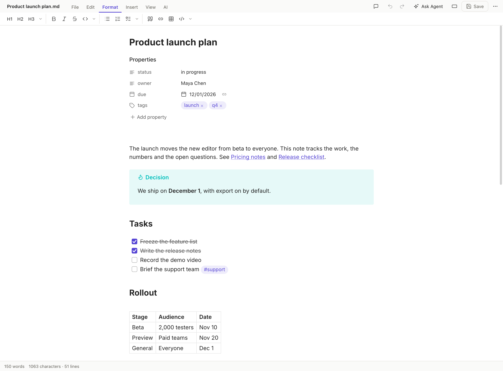

## What it does

### Why Note

- **Your file stays yours.** Opening and saving gives back the same bytes, line endings, byte
  order mark and spacing included. Edit one table cell and `diff` finds one line changed.
- **Obsidian-flavoured Markdown.** Properties, wikilinks, callouts, tasks, tables, footnotes,
  math and Mermaid, in plain `.md` files that any other tool still reads.
- **Built for agents.** Agents edit notes through MCP tools that run the same engine and commands
  as the editor, with revision checks so neither side overwrites the other.
- **Embeds in any web page.** The editor runs in a sandboxed frame on your own origin, over your
  storage and your users. No Kition server in the loop.
- **Fast and safe.** The engine is Rust, compiled to WebAssembly and run in a Web Worker, so long
  notes never block your page.
- **Open source.** Apache-2.0, engine and editor.

### See it

<table>
<tr>
<td width="50%">
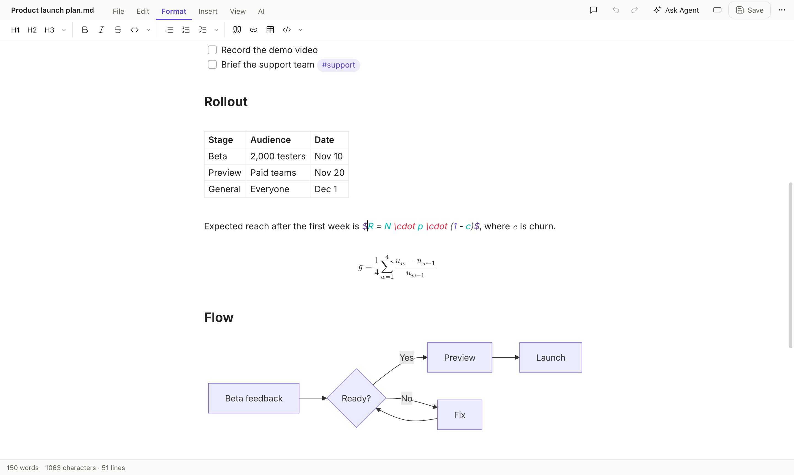
<p><b>Live preview editing.</b> Read the note as it looks; the Markdown appears only where the caret is. Math is typeset, Mermaid diagrams are drawn, callouts and tasks look like themselves.</p>
</td>
<td width="50%">
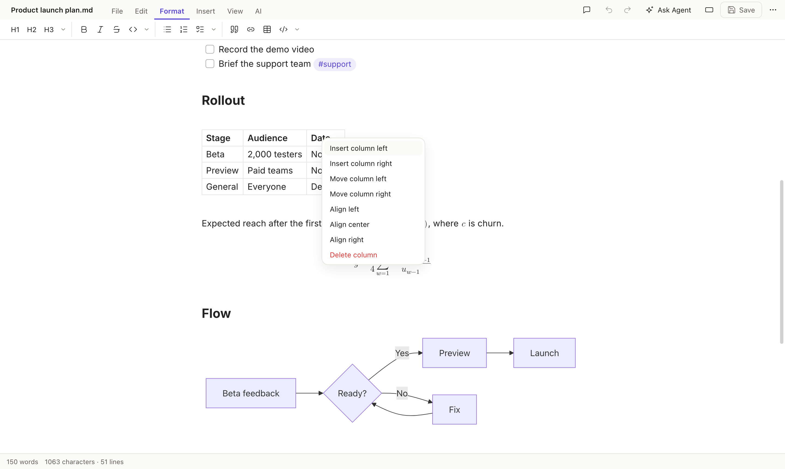
<p><b>Tables you can work with.</b> Type in a cell, then insert, move, align or delete rows and columns from the table itself. Each action changes only the lines it is about.</p>
</td>
</tr>
<tr>
<td width="50%">
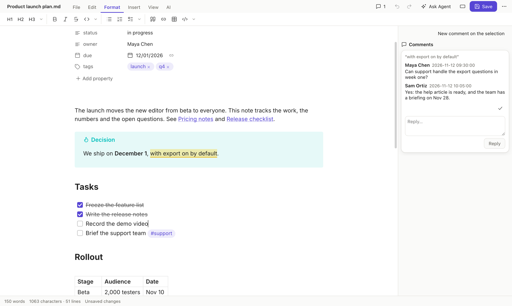
<p><b>Comments beside the file.</b> Threads anchor to the text they discuss and follow it as the note changes. They live beside the note, never inside the <code>.md</code>.</p>
</td>
<td width="50%">
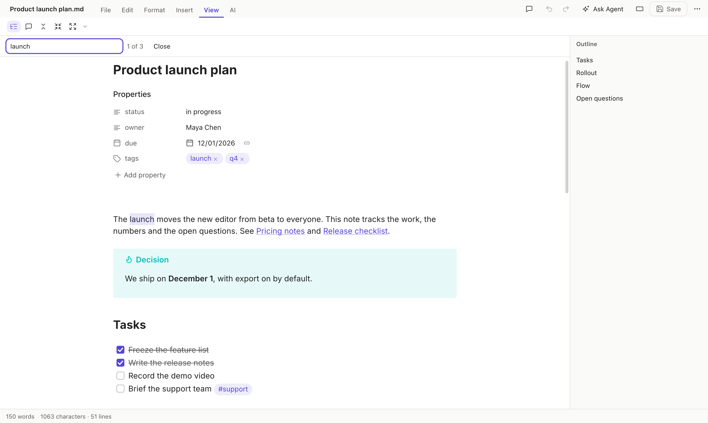
<p><b>Find and outline.</b> Find and replace with a match count, an outline of the headings to jump around, and folding for long notes.</p>
</td>
</tr>
</table>

### The file stays byte for byte yours

<table>
<tr>
<td width="50%">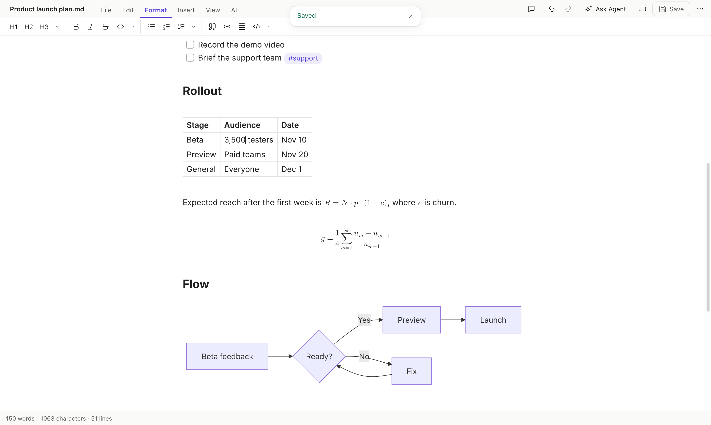</td>
<td width="50%">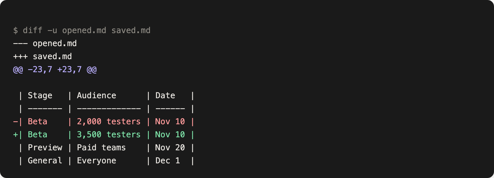</td>
</tr>
</table>

A note is the text of its file, not a document rebuilt from a parse. Above, one cell typed in the
editor and saved: `diff` finds one line changed, with the table's padding kept. Reformatting a
whole table or list is always a separate, explicit command.

### Export: HTML, PDF and pictures

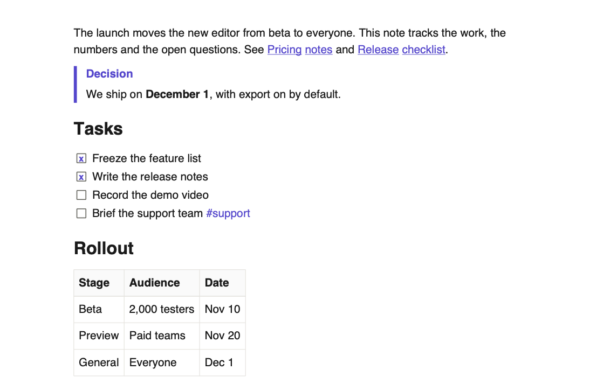

Export a note as a standalone HTML page, as a PDF on Letter or A4 pages, or as a picture (PNG,
JPEG, WebP, GIF, AVIF or SVG) through the host. Before a PDF is written, the dialog counts the
pages and says what they cannot draw. In a PDF today, display math and Mermaid diagrams appear as
their source.

### Made with Note

<table>
<tr>
<td width="25%"><a href="https://github.com/KitionAI/kition-showcase/tree/main/note/lakeside-camping-checklist">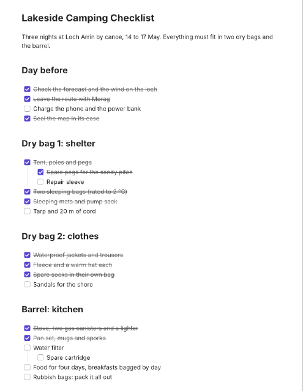</a></td>
<td width="25%"><a href="https://github.com/KitionAI/kition-showcase/tree/main/note/mechanics-revision-formulas">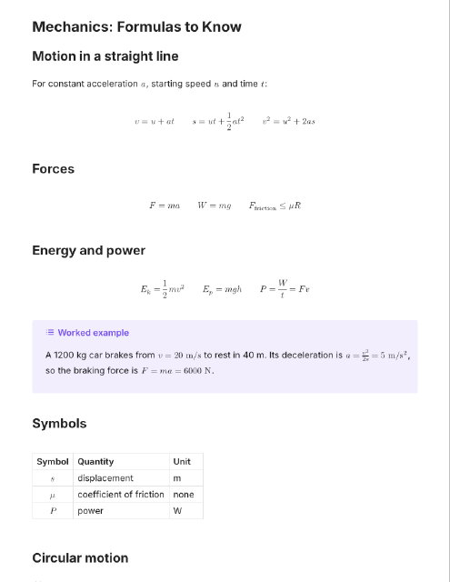</a></td>
<td width="25%"><a href="https://github.com/KitionAI/kition-showcase/tree/main/note/parcel-tracking-api-reference">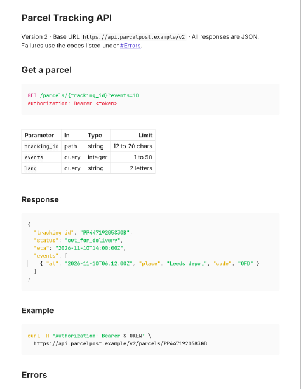</a></td>
<td width="25%"><a href="https://github.com/KitionAI/kition-showcase/tree/main/note/sourdough-starter-guide">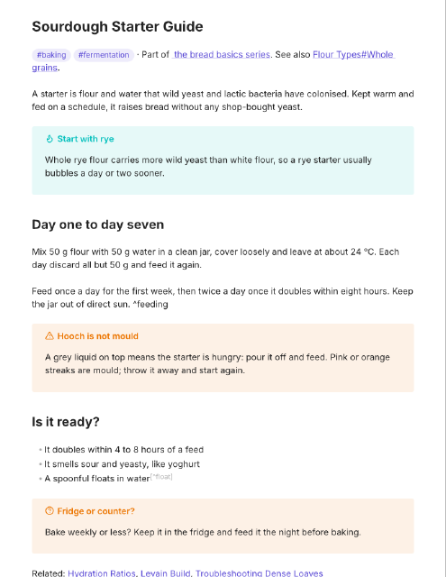</a></td>
</tr>
</table>

Every sample is built with Note's own commands. [See all of them](https://github.com/KitionAI/kition-showcase/tree/main/note).

### Formats

| Format | Extensions | MIME type | Role |
| --- | --- | --- | --- |
| markdown | .md, .markdown | `text/markdown` | edit |

## Quick start

- **In Kition**: open a `.md` or `.markdown` file; Kition shows this editor, and its agent edits
  the same file.
- **In your app**: host the kit's package and mount it with `@kition/embed`, below.
- **From an agent**: serve the headless `kition-note` executable as MCP tools, below.

### Embed it in your app

Note's editor is a static package you host yourself, mounted into your page with the Kition
SDK's [`@kition/embed`](https://www.npmjs.com/package/@kition/embed). You keep the files and the
users; the editor reads and writes through the functions you give it.

1. Download `kition-note-<version>.tgz` from the
   [latest release](https://github.com/KitionAI/kition-note/releases/latest) and serve its
   `note-ui/` folder as static files on its own origin, with the headers in the
   [embed reference](https://github.com/KitionAI/kition-sdk/blob/main/docs/platform/reference/embed.md).
2. Install the SDK and mount the editor:

```sh
npm install @kition/embed
```

```ts
import { KitionEmbed } from '@kition/embed'

const editor = await KitionEmbed.mount(document.getElementById('note')!, {
  kit: { id: 'kit.note', url: 'https://kits.example.com/note-ui/' }, // the package you host
  file: { id: 'plan-2026', name: 'Plan.md' },
  storage: {
    read: async (id) => api.read(id),                    // { bytes, version }
    write: async (id, bytes, { expectedVersion }) =>     // refuse a stale version
      api.write(id, bytes, expectedVersion),             // { version }
  },
  identity,          // optional: who is editing, and edit / comment / view per file
})
```

Every save carries the version it read, so an edit made elsewhere is never written over. Add
co-editing, comments, link handling, theming, and an agent working inside the open editor with
its changes shown for review: the [embed guide](https://github.com/KitionAI/kition-sdk/blob/main/docs/sdk/embed.md)
covers each, and [`examples/embed-app`](https://github.com/KitionAI/kition-sdk/tree/main/examples/embed-app)
is a complete page with a file list.

### Give it to your agent

The engine also runs headless, and `kition`, the Kition SDK's command line, serves it as MCP tools
(`note_inspect`, `note_run`, `note_check`, ...) on a folder of notes, for any MCP client. Nothing
is compiled: you need neither Rust nor the Kition app. Install `kition`, then connect your agent
in the folder:

```sh
curl -fsSL https://github.com/KitionAI/kition-sdk/releases/latest/download/install.sh | sh
# Claude Code, in the folder:
claude mcp add kition -- ~/.kition/bin/kition mcp --workspace "$PWD"
```

On Windows, install it with
`irm https://github.com/KitionAI/kition-sdk/releases/latest/download/install.ps1 | iex`. With
Node.js 20 or later you can skip the install:
`claude mcp add kition -- npx -y @kition/kits-mcp --workspace "$PWD"`.

`kition` holds no kit. The first time the agent opens a `.md` file, through the `kit_inspect`
tool the server offers until Note is installed, `kition` downloads Note's headless executable
into `~/.kition/kits` and the note tools appear. `kition kit install note` downloads it ahead of
time, and `kition kit upgrade` moves it to the newest version. Claude Desktop, Cursor, Codex and
the other commands are in the SDK's
[agent guide](https://github.com/KitionAI/kition-sdk/blob/main/docs/sdk/agent.md#connect-your-agent)
and [`kition` guide](https://github.com/KitionAI/kition-sdk/blob/main/docs/sdk/cli.md). To run
a build of your own (working on the kit itself), see
[docs/development.md](docs/development.md#run-the-headless-kit-for-an-agent).

A real session on the sample note, abridged:

```text
> note_inspect {"path":"launch.md","preview":false}
Opened `launch.md`: 816 × 1651
  headings 4, tasks 2/4 done, tables 1, words 150, revision oku0

> note_run {"path":"launch.md","basis":"oku0","steps":[
    {"command":"table.setCell","params":{"table":0,"row":1,"column":1,"text":"3,500 testers"}},
    {"command":"task.toggle","params":{"line":19}}]}
Ran 2 commands on `launch.md` (saved): 816 × 1651 Changes: objects 5 changed.

# Meanwhile the person moves the preview to Nov 18 in their own editor.

> note_run {"path":"launch.md","basis":"oku1","steps":[
    {"command":"table.setCell","params":{"table":0,"row":2,"column":2,"text":"Nov 22"}}]}
ERROR conflict: Others (outside) changed what this write acts on since your basis [...]
Nothing was run.

> note_run {"path":"launch.md","basis":"oku1","steps":[
    {"command":"property.set","params":{"key":"status","value":"ready"}}]}
Ran 1 commands on `launch.md` (saved): 816 × 1651 Changes: objects 2 changed.
Others changed 3 object(s) since your basis (by outside): see `others`.
```

Every write names the revision it read (`basis`). A write that rests on something another writer
has since changed is refused, and nothing is lost; a write about something else goes through.
The agent's guide is [agent/guide.md](agent/guide.md).

## Maturity

Version 0.1.2 (`kit.json`, changes in [CHANGELOG.md](CHANGELOG.md)); KHP 1.0, conformance level `basic`.

The feature catalogue (`features.yaml`) lists every feature with its status and the cases that
prove it; known gaps are in [docs/gaps.md](docs/gaps.md).

Note is the first kit published from [Kition](https://kition.ai), together with the
[Kition SDK](https://github.com/KitionAI/kition-sdk) it is built on.

## Build and contribute

Build and test instructions are in [docs/development.md](docs/development.md). Read
[CONTRIBUTING.md](.github/CONTRIBUTING.md) before opening a pull request, and ask questions in
[Discussions](https://github.com/KitionAI/kition/discussions) or on [Discord](https://discord.gg/bFSjRDjVY).

## License

Apache-2.0 ([LICENSE](LICENSE)). Third-party licenses and notices are listed in [NOTICE](NOTICE)
and [docs/attribution.md](docs/attribution.md).
