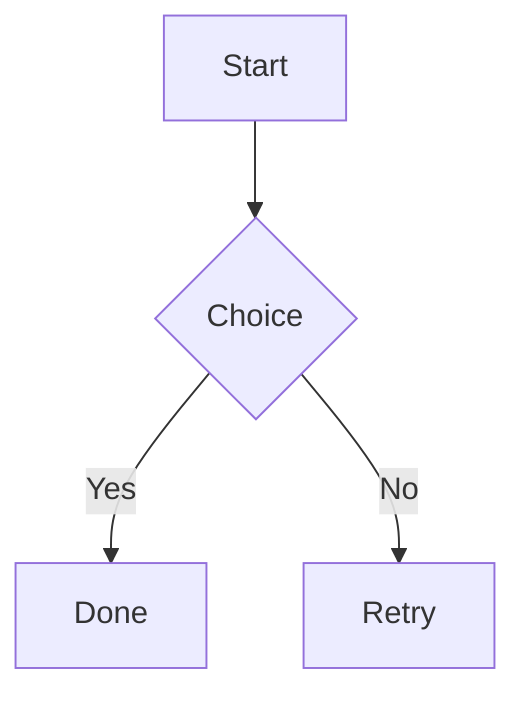

# Math, diagrams, and embeds

Inline math $E = mc^2$ in a sentence.

$$
\int_0^1 x^2 \, dx = \frac{1}{3}
$$

An embedded note:

![[01 Text formatting]]

<kbd>Ctrl</kbd> + <kbd>C</kbd> and a %%hidden comment%% here.
